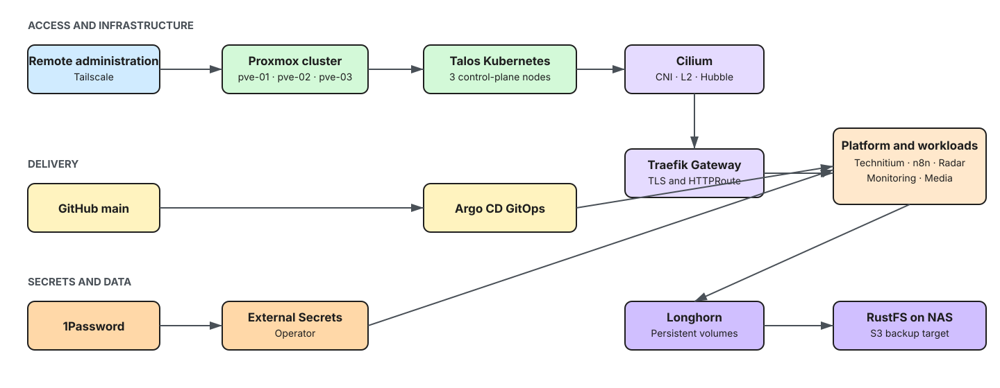

# Lobo Tech Works Homelab

GitOps-managed homelab infrastructure running Talos Linux and Kubernetes on a three-node Proxmox cluster.

[Documentation](docs/index.md) · [Architecture](docs/architecture.md) · [Operations](docs/operations/health-checks.md)



## Platform

- **Compute:** Proxmox VE hosts running a three-node Talos Kubernetes control plane.
- **Delivery:** Argo CD reconciles Kubernetes configuration from this repository.
- **Networking:** Cilium, Traefik Gateway API, cert-manager, and Technitium DNS.
- **Data:** Longhorn persistent volumes, NFS CSI, and RustFS-backed backups.
- **Operations:** Prometheus, Alertmanager and Grafana.

The repository is the executable source of truth. Terraform defines virtual infrastructure; Kubernetes manifests and Helm values define cluster state; the Taskfile defines supported operator commands.

## Repository structure

```text
infrastructure/proxmox/  Terraform, Talos configuration, and VM definitions
kubernetes/              Argo CD applications, Helm values, and Kustomizations
docs/                    Zensical documentation source
scripts/                 Operator utilities
Taskfile.yaml            Supported local commands
```

## Getting started

```bash
mise install
task --list
```

## Documentation

The [documentation site source](docs/index.md) covers architecture, inventory, platform services, applications, operations, alerting, runbooks, post-incident reviews, and architecture decision records.
