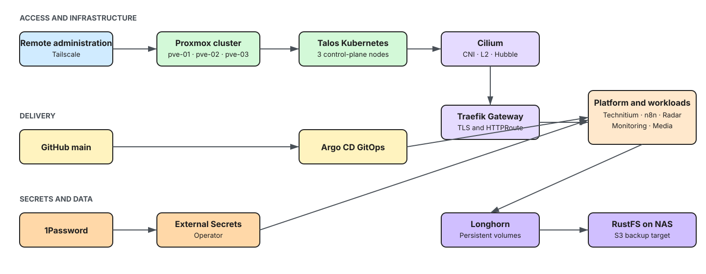

# Architecture

Three Proxmox hosts form the quorate `cluster-01` virtualisation cluster and run a three-member Talos Linux control plane. The cluster is intentionally control-plane schedulable; no worker nodes are declared in this repository. Argo CD reconciles platform and workload definitions from GitHub.

## Control and data paths

| Path | Design |
| --- | --- |
| Provisioning | Terraform creates Proxmox VMs, applies Talos machine configuration, and bootstraps etcd on the first control-plane node. |
| GitOps | The bootstrap task installs Cilium and Argo CD. Argo CD then reconciles its root application and child applications. |
| Ingress | Cilium advertises LoadBalancer addresses at L2. Traefik owns the `internal` Gateway and terminates TLS for `*.home.lobotechworks.pt`. |
| DNS | Technitium serves internal DNS; ExternalDNS writes A records through RFC 2136/TSIG. |
| Persistent data | Longhorn provides RWO volumes and backs up to an S3-compatible RustFS target. NFS CSI provisions a separate NAS-backed storage class. |
| Secrets | 1Password supplies Terraform inputs and runtime Kubernetes secrets; secret values are never stored in Git. |

