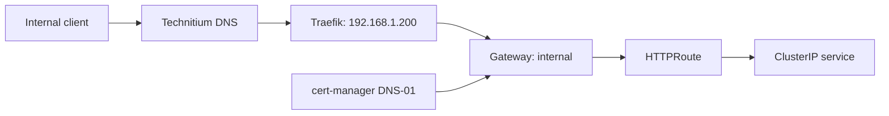

# Networking and traffic

## Network model

The Kubernetes API virtual IP is `192.168.1.210`. Each Talos control-plane VM receives a static private address; all three control planes advertise the virtual IP. Cilium replaces kube-proxy, uses Kubernetes IPAM, and advertises selected LoadBalancer addresses over L2.

Only Services labelled `homelab.lobotechworks.pt/load-balancer: main` are eligible for the declared Cilium address pool. Traefik is pinned to `192.168.1.200`; Technitium is pinned to `192.168.1.230`.

## Ingress and TLS

Traefik exposes an `internal` Gateway with HTTPS on its secure listener. HTTP is redirected to HTTPS. The Gateway requests a wildcard certificate for `*.home.lobotechworks.pt`; cert-manager uses the production Let's Encrypt ACME endpoint and a Cloudflare DNS-01 solver.

Routes may be accepted from all namespaces. An `HTTPRoute` is the only declared web-exposure mechanism for the services in this repository.

## Internal DNS

Technitium is the authoritative in-cluster DNS service exposed as TCP/UDP 53 through Cilium. It accepts recursion only from private networks and forwards upstream queries to Cloudflare DNS over TLS. ExternalDNS watches DNSEndpoint, Ingress, and Gateway HTTPRoute sources and synchronizes managed DNS records in `home.lobotechworks.pt` using RFC 2136 with TSIG authentication.

ExternalDNS keeps TXT ownership records with owner ID `homelab` and a one-minute reconciliation interval.

!!! info "Access"

    The URLs and DNS names in this documentation are internal service locations. They do not show who can access a service or whether it is reachable from the Internet.
